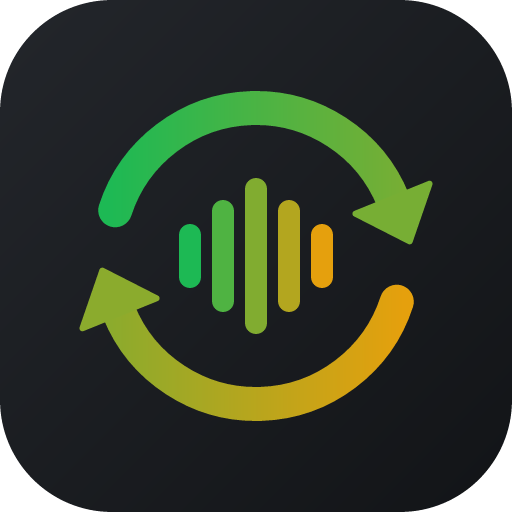

<p align="center"></p>

# AutoSpotifySync

> The ultimate tool to sync Spotify to Plex: find what's missing, auto-download it, and keep your playlists in sync.

Sync your Spotify library into a local SQLite database, cross-reference it with your Plex
music library, and report what is missing. Later milestones add automatic download (via a
companion [spotify-downloader](https://github.com/Hunter-Clipper/spotify-downloader) API),
import, and verification. See [PLAN.md](PLAN.md) for the design and roadmap.

**Status:** feature-complete first version, not yet field-tested against a live
Spotify/Plex/downloader. Expect rough edges and please report them.

## How it works
1. **Sync** your Spotify library (playlists, Liked Songs, saved albums) into SQLite.
2. **Match** every track against your Plex library (fuzzy artist and title; any release of a
   song counts). Low-confidence matches go to a `review` list.
3. **Download** (opt-in) each missing track via the downloader API, one job per track,
   rate-limited and capped per run.
4. **Check** the file (size, readable, duration within tolerance of Spotify's), **tag** it,
   and **import** it to `Artist/Album/NN - Title.ext` under `/music`.
5. **Verify**: trigger a Plex scan of just that folder and confirm Plex lists the track.
   Only then is it marked complete. Failures retry with backoff, then park for review.

6. **Playlists** (opt-in, `PLEX_SYNC_PLAYLISTS=true`): mirror each Spotify playlist and Liked
   Songs into a Plex playlist with the **same name**, containing the tracks you have, in
   Spotify's order. It fills in as downloads complete. One way only (Spotify to Plex): edits to
   the Plex copy are overwritten. Only playlists this tool created are ever changed or deleted;
   a same-named playlist you made yourself is left alone. Set `PLEX_PLAYLISTS_DRY_RUN=true` to
   preview what it would do (logged, nothing changed) while downloads stay live. Saved albums are not turned into
   playlists. Run it on demand with the `playlists` command.

**Safe by default:** `AUTO_DOWNLOAD=false` and `DRY_RUN=true`. To go live set
`AUTO_DOWNLOAD=true` **and** `DRY_RUN=false`. A dry run logs exactly what would be downloaded.

> **Legal:** intended for personal use with music you are entitled to have. You are
> responsible for complying with the terms of the services you use and the laws that apply
> to you.

## Spotify access modes
| Mode | Needs | Sees |
|---|---|---|
| Public-only | `SPOTIFY_CLIENT_ID`, `SPOTIFY_CLIENT_SECRET`, `SPOTIFY_PLAYLIST_URLS` | Listed **albums** only (see limits) |
| Full library | Above, plus `SPOTIFY_REFRESH_TOKEN` | Your playlists, Liked Songs, saved albums |

Generate the refresh token once with the built-in command. It works from any machine: you
approve in your own browser, then paste the (failed-to-load) redirect URL back.
Register `http://127.0.0.1:8888/callback` as a redirect URI in your Spotify app first
(Spotify does not allow `localhost`; set `SPOTIFY_REDIRECT_URI` to use a different one).

```bash
docker run --rm -it -e SPOTIFY_CLIENT_ID=... -e SPOTIFY_CLIENT_SECRET=... autospotifysync auth
```

### Spotify API limits to know about
Per Spotify's February 2026 API changes (which apply to apps in development mode):
- Playlist contents are only returned for playlists **you own or collaborate on**. Playlists
  you merely follow are skipped with a warning.
- A client-credentials token (no user) cannot read playlist contents, so public-only mode
  only works for albums.
- Development-mode apps allow 5 allowlisted users, and the app owner needs Premium.
- Refresh tokens last about 6 months, then you must generate a new one.

## Run
```bash
cp .env.example .env   # fill in values; never commit .env
docker build -t autospotifysync .
docker run --rm --env-file .env -v /path/to/appdata/autospotifysync:/config autospotifysync sync
docker run --rm --env-file .env -v /path/to/appdata/autospotifysync:/config autospotifysync missing
```
The container runs as `99:100` (Unraid `nobody:users`); `/config` must be writable by it.

Commands: `daemon` (container default), `run` (one full pass), `sync`, `status`,
`missing`, `review`, `failed`, `retry [trackId]`, `playlists`, `auth`. Run any of them by appending the
command to the `docker run` line.

Unraid: a template is in [`unraid/autospotifysync.xml`](unraid/autospotifysync.xml). The
container needs `/config` (appdata) and `/music` (the same share Plex reads) mounted
read-write, and runs as `99:100`.

Notifications: set `NOTIFY_URL` to a Discord, Slack or Gotify webhook.

## Develop
```bash
npm ci
npm test
npm run typecheck
npm run dev -- status
```
Requires Node 22.13+ (uses built-in `node:sqlite`).
